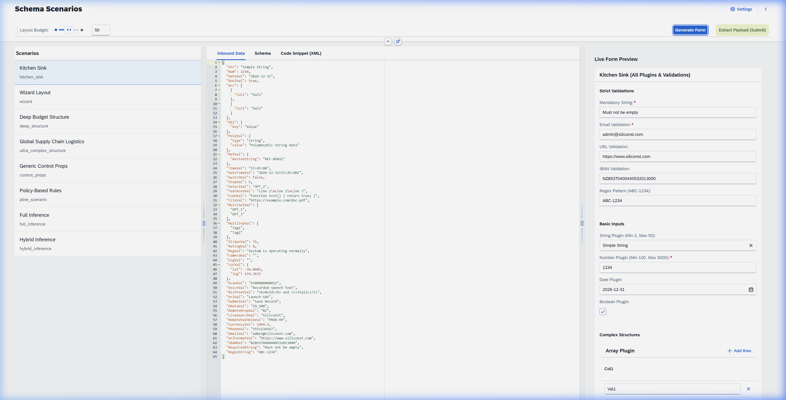

# MetaUI

**MetaUI** is an extensible, metadata-driven UI engine built on top of SAP UI5. Instead of relying on static XML views, it parses standard JSON Schema definitions at runtime to dynamically generate SAP Fiori component trees. This enables server-driven architectures where the UI structure and data bindings are determined entirely by the incoming payload.

[](https://SiliconStreetDev1.github.io/MetaUI/index.html)
[](LICENSE)



## MetaUI vs. Fiori Elements

It is important to note that MetaUI is **not** an attempt to replace SAP Fiori Elements. Fiori Elements is a robust framework for building UIs driven by static OData CDS annotations. 

MetaUI is designed as a complementary tool for highly dynamic use cases where CDS annotations are unavailable, impossible, or too rigid. By relying on universal JSON Schema, MetaUI provides a flexible alternative for scenarios that demand on-the-fly, runtime layout generation.

## Requirements

**MetaUI runs on OpenUI5 and on SAPUI5**, with every widget available on both.
Verified on OpenUI5 **1.120.50** from the OpenUI5 CDN (`https://sdk.openui5.org/`):
the form, the layouts, and the `codeEditor` and `fileUploader` widgets all render.

MetaUI eagerly depends on `sap.ui.core`, `sap.m` and `sap.ui.layout` only.
`sap.ui.unified` (`fileUploader`) and `sap.ui.codeeditor` (`codeEditor`) are
declared lazy and are loaded on demand, the first time a schema actually asks for
one of those widgets. Both ship with OpenUI5 as well as SAPUI5, so the lazy
declaration is about payload size, not availability — there is no SAPUI5-only
dependency anywhere in the library.

> **Not verified:** lazy library resolution on a Fiori Launchpad resolves through
> the SAP App Index rather than the AMD loader. That path has not been tested.

### Declare MetaUI as a library, not just a resource root

> **Required, not optional.** UI5 only fetches a library's `library-preload.js`
> when the library is **named as a library** — in `data-sap-ui-libs`, or in your
> app's `manifest.json` under `sap.ui5.dependencies.libs`. Pointing
> `data-sap-ui-resourceroots` at MetaUI without also declaring it makes the AMD
> loader resolve every module individually, in serialised waves.
>
> Measured on OpenUI5 1.120.50 rendering one eight-field form: **2 HTTP requests
> when declared (`library-preload.js` plus the message bundle), 87 when only the
> resource root is set.** On localhost the difference is easy to miss; across a
> real network those 87 resolve in serialised waves and dominate first render.

```html
<script id="sap-ui-bootstrap"
        src="https://sdk.openui5.org/resources/sap-ui-core.js"
        data-sap-ui-theme="sap_horizon"
        data-sap-ui-libs="sap.m, sap.ui.core, sap.ui.layout, nz.co.siliconst.ui5.metaui"
        data-sap-ui-resourceroots='{ "nz.co.siliconst.ui5.metaui": "./resources/nz/co/siliconst/ui5/metaui" }'
        data-sap-ui-async="true">
</script>
```

Inside a UI5 Tooling application, the equivalent is a `manifest.json` entry:

```json
"sap.ui5": { "dependencies": { "libs": { "nz.co.siliconst.ui5.metaui": {} } } }
```

MetaUI does not load its own library at runtime to paper over a missing
declaration: by the time any MetaUI code executes, the loader has already walked
the module graph that the declaration exists to replace, and loading the whole
library from a control would also defeat the on-demand plugin loading above.

## Quickstart

**1. Install**
```bash
npm install @siliconst/metaui
```

**2. Add to your XML View**
```xml
<meta:DynamicHost
    schemaDefinition="{yourModel>/schema}"
    data="{yourModel>/payload}"
    submit=".onFormSubmitted"
/>
```

**3. Define a schema** (or let MetaUI infer one from your data)
```json
{
  "title": "Guest Registration",
  "type": "object",
  "properties": {
    "FullName":   { "type": "string", "maxLength": 100 },
    "Email":      { "type": "string", "ui": { "format": "email" } },
    "CheckIn":    { "type": "date" },
    "VIP":        { "type": "boolean", "ui": { "widget": "switch" } }
  },
  "required": ["FullName", "Email"]
}
```

That's it. MetaUI handles the `sap.m.Input`, `sap.m.DatePicker`, `sap.m.Switch`, validation, labels, and responsive layout automatically.

## Key Features

- **51 `(type, widget)` plugin mappings** (canonical counts via `npm run metrics`) — Strings, numbers, dates, polymorphic `oneOf`/`anyOf` selectors, dictionary maps, cameras, signatures, code editors, OData/REST value helps, and more
- **4 layout strategies** — Form, Table, Wizard (step-by-step), Compact
- **Policy-Based Rules Engine** — Declarative cross-field logic (Show/Hide/Require/Disable) with automatic symmetrical reversals
- **Tri-Binding Engine** — Feed data as an object, JSON string, or OData context
- **Full Inference Mode** — Pass raw data with no schema; MetaUI generates the UI automatically
- **OpenAPI / Swagger support** — Extract schemas directly from API specs

## 📚 Documentation

Full documentation covering schemas, plugins, policies, and integration guides:

- **→ [MetaUI Documentation Wiki](docs/wiki/Home.md)**
- **→ [Supported Features & Known Limitations](docs/wiki/SupportedFeatures.md)**

## 🔒 Security

MetaUI treats the schema it renders as **untrusted input**. Control properties, binding expressions, URLs and regular expressions supplied by a schema are each validated before they reach a UI5 sink, and a directive that fails validation is refused and logged rather than applied.

Two things need a decision from you before you render schemas your application did not author:

- **Cross-origin data sources are permitted by default.** `ui.dataSource.url` is always scheme-checked (`http:` / `https:` only), but a cross-origin endpoint is allowed with a one-time warning. Call `UrlValidator.setDataSourceOriginPolicy("same-origin")` — or `("allowlist", [...])` — at startup to change that.
- **A `pattern` that cannot be proven safe still runs once.** Provably ambiguous regular expressions are refused outright; anything else is executed and quarantined for the session only after it overruns its 50 ms budget, so one unbounded evaluation is possible.

The full trust model — what a schema may do, what it is prevented from doing, by which named mechanism, and what residual exposure remains — is in [Supported Features § Security Posture & Trust Model](docs/wiki/SupportedFeatures.md).

## ⚖️ License

MIT — see [LICENSE](LICENSE) for details.

> **Disclaimer**: This software is provided "as is", without warranty of any kind. Use at your own risk.
